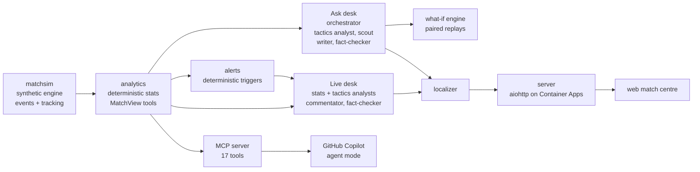

# Matchday Newsroom

A newsroom of AI agents that watches a synthetic football match and turns its events into explainable match
intelligence: live fact-checked commentary, answers to any question, tactical breakdowns, what-if replays and
half-time / full-time reports. The same match reads differently for a fan, an analyst and a scout, in nine
languages. Built for the Microsoft "Inside the Game" hackathon on **Microsoft Foundry** and the **Microsoft Agent
Framework**, deployed on **Azure Container Apps**.

> All data is synthetic. Clubs, players and results are fictional and made by our own match engine. No real
> footage, data, names or badges are used.

**Live demo:** _URL added after deploy_ · **Video:** _link added after upload_

## Try it (for judges)

The demo is free and needs no login. It opens on a finished match with all the stored commentary, recaps and
stats. Questions, what-ifs, translations and voice call the agents live. The app scales to zero when nobody is using
it, so the first load after a quiet spell is slow while the container starts.

1. **Pick a match** in the title bar. There are five: for example Harlow Athletic 3-3 Stonebay Albion, or
   Redmere City 5-0 Ashmere Town.
2. **Press play** or drag the timeline. Lower-third overlays and the feed follow the clock. Toggle **3D** under the pitch.
3. **Switch persona** in the activity bar on the left (Fan / Analyst / Scout). The same moment is written three ways.
4. **Settings** (the gear): pick a favourite club, a metric to follow, a language (for example Español or 日本語)
   and the units. The feed, overlays and answers all follow these settings.
5. **Ask** tab: type a question, for example "Why did the away side lose control after the break?". Each answer
   shows its audit trail: which agents ran, which tools they called and what the fact-checker said.
6. **What-if** tab: change a team's pressing or tempo from any minute and replay the rest of the match against the
   original. Or press **Advise the manager**: the bench assistant proposes two changes and tests each with 12 paired
   simulations (about 2 minutes).
7. **Live run**: streams the match on the server clock while the newsroom covers each moment as it arrives.
8. **Scout**: click any player to see every touch, a touch map, how hard they are running and their defensive duties.
9. **Clips**: suggested key moments, adjustable range, export as JSON or as a broadcast pack (timed overlay cues
   plus studio talking points) in the chosen language.

The free demo has a daily allowance for new model calls. Everything that is cached or stored keeps working after it runs out.

## What it does, against the brief

| Stage | How |
|---|---|
| **Ingest** | The engine emits 37 event types (passes, shots, tackles, pressure, possession changes, cards, VAR, injuries, offsides and more; [EVENTS.md](EVENTS.md)) plus 5 Hz tracking. Live run streams them as they happen. |
| **Interpret** | `analytics/` computes every displayed number deterministically: stats and ratings, PPDA, pass length and difficulty, ball and shot speed, sprints and distance, formation reader, pressing, momentum, win probability, control vs chaos, fatigue, defensive duties, milestones. |
| **Explain** | The agents choose which numbers matter and explain why the moment happened (shape changes, pressing spells, tiring players), using only tool output. Every engine decision also carries a `why` rationale. |
| **Render** | Match centre with timed lower thirds, a live feed, a tactics board (shapes, pass networks, press, momentum), breakdowns you can pause and draw on, a 3D view, and a machine-readable broadcast pack. |
| **Personalise** | Fan / Analyst / Scout personas, favourite club, followed player, a metric to follow, nine languages (localizer agent plus a number-preservation check), metric / imperial units, spoken commentary. |

## Architecture



**Rule we hold everywhere:** the engine produces facts only, analytics produces every number, and the agents add the
insight: what matters, why, for whom, in which words. Agents may only quote numbers that came from a tool.

### The agents (Microsoft Agent Framework on Foundry, `gpt-4.1-mini`)

- **Live desk** (`newsroom/agents.py`). For each key moment, a **stats analyst** and a **tactics analyst** read the
  fact pack. A **commentator** writes the line in a persona's voice, and a **fact-checker** approves or rejects it,
  sending its issues back for up to two rewrites.
- **Ask desk** (`newsroom/desk.py`). An **orchestrator** calls the **tactics analyst** and the **scout** as tools,
  and they call analysis tools and the what-if engine. A **writer** shapes the findings for the reader's profile, and
  the **fact-checker** reviews the result. The same desk writes the half-time and full-time recaps.
- **Bench assistant** (`Desk.advise`). A **manager assistant** proposes two changes, and each is tested with 12 paired
  simulations. The pick is made in code from expected points, and the writer and checker explain it.
- **Localizer** (`newsroom/localize.py`) translates published lines and keeps every name and number intact.

**Recovering from failures.** The LLM fact-checker is backed by deterministic checks (`unsupported_numbers`,
`wrong_leader`, `wrong_team`, a minute check). A line still rejected after the rewrites is never published: a
template built only from the fact pack goes out instead, and the held drafts stay in the audit trail. A translation
that loses or changes a number falls back to the original. Calls retry on 429, 5xx and timeouts. Without Azure
credentials, a scripted client runs the whole pipeline offline, which is how CI tests it.

**Measured accuracy.** `scripts/eval_newsroom.py` grades the answers against engine truth: 54 answers on the five
demo matches, 0.87 overall, 87 % approved by the fact-checker. Goals, best player, pressing, duties, milestones,
passing, control and the bench assistant all scored 1.0; formation changes scored 0.7 and fatigue 0.6. The results
are in `web/data/eval.json` and shown in the app.

## Microsoft technology used

| Technology | Where |
|---|---|
| **Microsoft Foundry** | Project `newsroom`, `gpt-4.1-mini` deployment, Responses API (`newsroom/clients.py`) |
| **Microsoft Agent Framework** | Every agent, agents used as tools by the orchestrator, tool calling, per-moment workflow (`agent-framework-*`) |
| **Foundry tracing / Application Insights** | OpenTelemetry via `azure-monitor-opentelemetry`; agent runs and tool calls appear on Foundry's Tracing page |
| **Azure AI Speech** | Spoken commentary (`/api/speak`), on the same Foundry resource |
| **Azure Container Apps** | `infra/deploy.ps1`: built in Azure, scales to zero, system-assigned managed identity with the Foundry User role, so there are **no keys** anywhere |
| **MCP + GitHub Copilot agent mode** | `server/mcp_server.py` exposes 17 tools (analysis, `what_if`, `ask_newsroom`), over stdio or HTTP; `.vscode/mcp.json` connects Copilot so an analyst can query a match from VS Code |
| **GitHub Actions** | `.github/workflows/tests.yml` runs the engine, stats, analytics and newsroom tests offline |
| **GitHub Copilot / Claude Code** | Development tools only. They are not part of the runtime. |

## Synthetic data: the engine

`matchsim/` is a football engine built for this project. Decisions are made from real geometry (passing-lane
interception, pressure on the receiver, xG and xT), and movement is a 5 Hz kinematic model with marking, pressing,
runs, support, width and block shape, all driven by tactics. Players have 14 attributes, 12 traits, footedness and
fatigue. There are benches with five substitutions and a manager who changes tactics with the score and the clock.
The ball's flight is resolved physically, so outcomes follow from where players actually are. The engine is
calibrated against real-football norms (`scripts/calibrate.py`, `scripts/tune_norms.py`); the method and every
attempt, including the ones that did not work, are in [DEVLOG.md](DEVLOG.md), and the design is in [DESIGN.md](DESIGN.md).

## Run it locally

Python 3.11.

```bash
pip install -r requirements.txt
python -m server.app                       # match centre + API on http://localhost:8080
```

Without `FOUNDRY_PROJECT_ENDPOINT`, the agents use the scripted offline client. For live agents:

```bash
powershell -File infra/setup.ps1           # one-time: Foundry resource, project, gpt-4.1-mini deployment, role, App Insights
# set FOUNDRY_PROJECT_ENDPOINT and FOUNDRY_MODEL, then run the server again
powershell -File infra/deploy.ps1          # publish to Azure Container Apps
```

Other entry points:

```bash
python scripts/run_match.py 7              # simulate a match -> out/match_7.json
python scripts/build_site.py out/match_7.json   # run the newsroom over it -> web/data/ and server/data/
python -m server.mcp_server [--http]       # the analysis tools as an MCP server
python scripts/eval_newsroom.py out/*.json # grade the newsroom against engine truth
python tests/test_sim.py; python tests/test_stats.py; python tests/test_tools.py; python tests/test_newsroom.py; python tests/test_mcp.py
```

## Repository map

`matchsim/` engine and what-if replays · `analytics/` stats, ratings and `MatchView` analysis tools · `newsroom/`
agents, checks, alerts and localizer · `server/` aiohttp app and MCP server · `web/` match centre (static, no
framework; three.js for 3D) · `scripts/` simulation, site build, eval and calibration · `infra/` Azure setup and deploy ·
`tests/` plain-script tests.

## Credits

The two-stream idea (events plus tracking frames) follows the SoccER synthetic-data paper (Morra et al., 2020); no
SoccER code or data is used. The 3D player is the CC0 Quaternius mannequin (`web/assets/LICENSE-player.txt`). The UI
colours follow VS Code's Dark Modern theme (MIT). The code is under the MIT licence ([LICENSE](LICENSE)).
